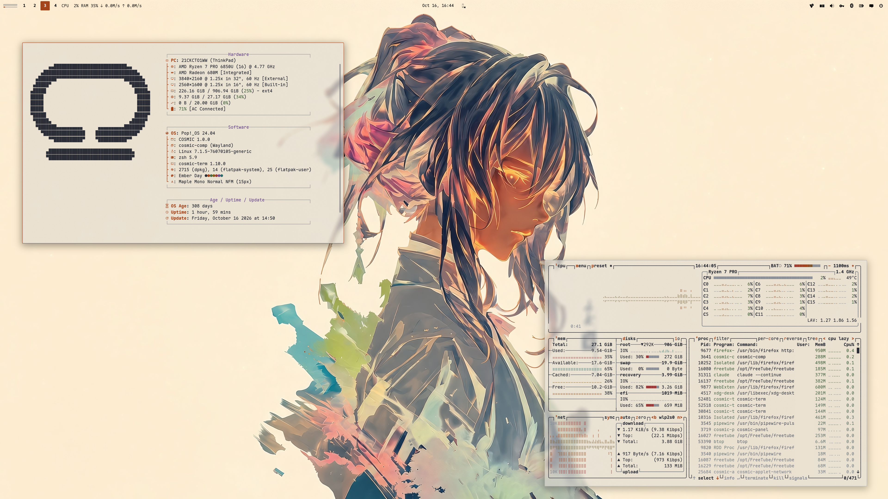

<div align="center">

# COSMIC · Ember Day

Pop!_OS 24.04 on COSMIC in Ember Day warm stone, ink and one ember accent: desktop,
terminal, shell, editor, Firefox, cursor, wallpapers. The light half of a pair;
the dark half is [cosmic-ember-theme](https://github.com/atraxsrc/cosmic-ember-theme).


</div>

---


## Palette

Ember is one design in two halves: cold blue-black night, warm stone day, one
ember accent shared by both. Big shapes (window, containers, text) are neutral; the
ember is small and loud (accent, window hint, commands) and everything else in the
ANSI set stays calm, pairing by lightness only. Every role you read as text clears
4.5:1 on the window `#E9E6DF`; the terminal is an opaque pane `#DDD9D1`, one step darker
than the desktop.

| Role | Color | Hex |
|------|-------|-----|
| Background |  Stone | `#E9E6DF` |
| Containers |  Linen / Pane | `#E2DED6` / `#DDD9D1` |
| Terminal |  Pane, opaque | `#DDD9D1` |
| Text |  Ink | `#2B2E36` |
| Accent |  Ember | `#A4441A` |
| Success |  Moss | `#4C6B45` |
| Warning |  Amber | `#8A5E12` |
| Error |  Brick | `#9E3A3A` |
| Blue |  Slate blue | `#2F5C8A` |
| Magenta |  Heather | `#6E4E8C` |
| Cyan |  Verdigris | `#2E6E6A` |
| Muted |  Muted | `#6B6F78` |
| Comment |  Comment | `#8C9099` |

Window hint `#A4441A`. Ratios per role are in `docs/showcase.md`, or run
`python3 scripts/contrast.py`.

| Role | Ember Day | Ember |
|------|-----------|-------|
| Background | `#E9E6DF` | `#15171C` |
| Text | `#2B2E36` | `#D6D9E0` |
| Accent | `#A4441A` | `#E8713A` |
| Success | `#4C6B45` | `#8FB58A` |

---

## Repo Structure

```
.
├── btop
│   └── EmberDay.theme           # btop colour theme
├── cosmic
│   ├── EmberDay.ron             # COSMIC Appearance import (Light)
│   ├── config/                  # baseline settings: fonts, icons, terminal look
│   └── install.sh
├── cosmic-term
│   └── EmberDay-term.ron        # COSMIC Terminal colour scheme (Light)
├── cursors
│   ├── Oxygen-EmberDay-*/       # cursor themes, one per icon colour, patched for COSMIC apps
│   ├── install.sh
│   ├── uninstall.sh
│   └── README.md
├── icons
│   └── install.sh               # Cosmic-EmberDay icon pack from cosmic-icon-themes
├── fastfetch
│   ├── config.jsonc             # ink / ember fastfetch config
│   ├── cosmic.txt               # COSMIC logo
│   └── install.sh
├── firefox
│   ├── theme                    # Cosmic Ember Day theme add-on (manifest + icons)
│   ├── chrome
│   │   ├── userChrome.css       # rounded chrome, ember menu hover
│   │   └── userContent.css      # new tab accents, blank tiles
│   ├── install.sh
│   └── README.md
├── lsd
│   ├── config.yaml              # theme: custom
│   ├── colors.yaml              # permission / size / date / git columns
│   └── install.sh
├── nvim                         # Neovim colorscheme, LazyVim spec, RON syntax, install.sh
├── scripts
│   ├── update_system.sh         # nala + flatpak, dark ANSI for a light terminal
│   ├── contrast.py              # palette contrast table, feeds the README
│   └── wallpaper.sh             # renders a wallpaper from any source image
├── zsh
│   ├── emberday.zsh             # LS_COLORS, highlighting colours, aliases, starship
│   └── install.sh
├── assets
│   ├── cursors/                 # cursor preview
│   ├── screenshot.png           # README screenshot
│   └── wallpaper.png            # the astronaut on the bare desktop
├── backgrounds/                 # five wallpapers, emberday-<subject>.png, and emberday.gpl
├── docs
│   └── showcase.md              # the rice describing itself, for the Postilla pane of the screenshot
├── LICENSE
└── README.md
```

---

## COSMIC Desktop

This is a **Light** theme, so it goes in COSMIC's Light slot:

Settings → Desktop → Appearance → **Light** → **Import** → `cosmic/EmberDay.ron`

Accent and window hint are the ember `#A4441A`, matching the other half.
Use the `+` control if you want a custom swatch.

Frosted glass is on in the `.ron` at `frosted: Low` with an opacity table of
0.66 to 0.96, tinted with the palette's middle neutral `#868686`, for windows, panel,
applets and system UI (maximized apps stay solid), and corners are squared
(`radius_*: 2.0`), the same as the DarkGold baseline. Adjust frosted glass on
Appearance → Style → Frosted glass after import; those sliders survive a theme switch.

**Known COSMIC bug:** moving the frosted glass opacity / thickness sliders can
reset `text_tint` to `#FFFFFF`, which on a light theme makes every label
unreadable. If your text turns white, re-import `cosmic/EmberDay.ron`: it
carries the ink tint and the whole frosted block, so one import restores both.
Upstream fix proposed in [libcosmic#1450](https://github.com/pop-os/libcosmic/pull/1450),
not merged.

Export from Appearance if you tweak backgrounds / tints so you do not lose them.

Pairing tip: import `Ember.ron` from
[cosmic-ember-theme](https://github.com/atraxsrc/cosmic-ember-theme) into the
Dark slot and COSMIC's Dark / Light toggle flips between the two. Wallpaper,
Firefox and the shell layer do not follow the toggle; those are per-rice files.

### Baseline settings

`cosmic/config/` holds the settings that make up the look and rarely change
(panel, dock, applets and shortcuts are left out on purpose):

| Where | Setting |
|-------|---------|
| Fonts | Interface `Maple Normal UI`, monospace `Maple Mono Normal NFM` |
| Icons | Cosmic-EmberDay-Ember |
| Windows | Minimize / maximize buttons hidden, theme applied to GNOME apps |
| Terminal | Maple Mono 15 (weights 500 / bold 800 / dim 300), opaque, no header bar, Ember Day (light scheme) |

Install the [Maple fonts](https://github.com/subframe7536/maple-font) and the
Cosmic-EmberDay icons (see Icons below) and import the terminal scheme first, then:

```bash
./cosmic/install.sh
```

It backs up each file it replaces to `*.bak` and COSMIC applies it live.

---

## COSMIC Terminal

The desktop `.ron` does not colour ANSI text.

1. COSMIC Terminal → **View → Color schemes…** (not Settings → Appearance)
2. **Light** tab → **Import** → `cosmic-term/EmberDay-term.ron`
3. View → Settings → Appearance → Color scheme (light) → **Ember Day**

If a profile is set as default, set the scheme on that profile too or the
dropdown will look like it did nothing.

Text on an opaque pane `#DDD9D1`, one step darker than the desktop; ember for
commands, moss for strings and success, amber for warnings, brick for errors,
slate blue for directories, verdigris for symlinks, heather in the magenta slot.

---

## Firefox

Two layers:

1. **Theme (colours):** install
   **[cosmic-emberday-theme on addons.mozilla.org](https://addons.mozilla.org/en-US/firefox/addon/cosmic-emberday-theme/)**.
   This is the main look.
2. **Stylesheets (optional):** `firefox/chrome/` adds rounded corners, ember
   menu hover, ember accents and blank new-tab tiles on top of the add-on
   (they also work with Firefox's built-in Light theme):

```bash
./firefox/install.sh
```

Fully quit Firefox afterward. Details and CSS rules: [`firefox/README.md`](firefox/README.md).

---

## Cursor

**Oxygen** cursors recoloured to the icon colours, one per folder colour of the
Cosmic-EmberDay icon pack: **Ember** (default), **Moss**, **Slate**, **Ink**. Patched with the cursor
names COSMIC apps ask for. COSMIC has no cursor picker yet, so the script sets it:

```bash
./cursors/install.sh                      # Ember
./cursors/install.sh --variant Moss      # or another, see --list
reboot
```

Previews, what the script touches, how to undo it and how the colours are made:
[`cursors/README.md`](cursors/README.md).

---

## Scripts

### `update_system.sh`

nala + flatpak updater. Headers in ink, info in ember, success in moss,
errors in brick; the banner ramps from ink to ember.

```bash
chmod +x scripts/update_system.sh
./scripts/update_system.sh
```

---

## Terminal extras

Need a [Nerd Font](https://www.nerdfonts.com/) in the terminal for the icons
(Maple Mono NFM in the baseline above).

### zsh

`zsh/emberday.zsh` is the rice part of the shell only: `LS_COLORS` (also used
by lsd for file names and by the completion menu), ember / moss / brick colours
for zsh-autosuggestions and zsh-syntax-highlighting, lsd / bat / nvim aliases
and the starship prompt. Your own `~/.zshrc` stays private and sources it.

Needs zsh + [oh-my-zsh](https://ohmyz.sh/). `install.sh` clones the two
plugins if missing and appends one `source` line to `~/.zshrc` (backup in
`~/.zshrc.bak`):

```bash
./zsh/install.sh
exec zsh
```

In `~/.zshrc` keep `ZSH_THEME=""` and
`plugins=(git sudo zsh-autosuggestions zsh-syntax-highlighting)`.

### lsd

File names are coloured by `LS_COLORS` from `zsh/emberday.zsh`;
`lsd/colors.yaml` colours the other columns with the 256-colour codes nearest
the palette (130 ember, 65 moss, 94 amber, 131 brick, 24 slate blue, 60 heather, 23 verdigris, 242 muted, 246 comment, 236 ink). lsd 1.0.0 does not accept `#hex` there.

```bash
./lsd/install.sh
lsd -l
```

### fastfetch

COSMIC logo in ink, Hardware / Software / Age boxes with ember keys. `install.sh` backs up any existing `~/.config/fastfetch/config.jsonc`
to `config.jsonc.bak`.

```bash
./fastfetch/install.sh
fastfetch
```

### Neovim

`nvim/` carries the rice into Neovim: a dependency-free colorscheme built from
the palette (`nvim/colors/emberday.lua`), a LazyVim spec that selects it and makes
sure the treesitter parsers for the files in this repo are installed
(`nvim/lua/plugins/emberday.lua`), and a small RON syntax file so `cosmic/*.ron`
is coloured even before the parser exists. `:terminal` inside Neovim uses the
Ember Day scheme.

```bash
./nvim/install.sh
# restart nvim; LazyVim switches to the emberday colorscheme
```

Without LazyVim, copy `nvim/colors/emberday.lua` to `~/.config/nvim/colors/` and
run `:colorscheme emberday`.

### btop

`btop/EmberDay.theme`: terminal background, ink boxes, ember highlights,
meters ramp from moss through ember to brick.

```bash
mkdir -p ~/.config/btop/themes
cp btop/EmberDay.theme ~/.config/btop/themes/
# btop → Esc → Options → Color theme → Ember Day
```

---

## Icons and wallpaper

Icons: **Cosmic-EmberDay**, the [Kanagawa icons](https://github.com/Fausto-Korpsvart/Kanagawa-GKT-Theme/tree/main/icons/Kanagawa)
by Fausto Korpsvart recolored to this palette in
[cosmic-icon-themes](https://github.com/atraxsrc/cosmic-icon-themes). Folders come in
four colors: **Ember** `#A4441A` (default), **Moss** `#4C6B45`, **Slate** `#2F5C8A` and **Ink** `#2B2E36` with ember symbols.


```bash
./icons/install.sh                  # Ember folders
./icons/install.sh --variant Moss   # or Slate, Ink
```

It downloads the pack from the latest cosmic-icon-themes release, checks its SHA256,
installs it to `~/.local/share/icons/` and sets it as the COSMIC icon theme.
Restart open apps afterwards (Files caches icons per window).
Add `--system` to install to `/usr/share/icons` instead, for every user and the
login screen (asks for sudo); `--user` is the default.

Five subjects rendered by `scripts/wallpaper.sh` from
[cool-wallpapers](https://github.com/atraxsrc/cool-wallpapers), named `emberday-<subject>.png`
in [`backgrounds/`](backgrounds/): astronaut (the one in the screenshot), samurai,
geisha, city and the eagle; `emberday.gpl` sits beside them for GIMP work. Any other
source renders with one command:

```bash
./scripts/wallpaper.sh day path/to/source.png backgrounds/emberday-<subject>.png
```

Settings → Wallpaper → Add image → a file from `backgrounds/`.


---

## Setup

```bash
git clone https://github.com/atraxsrc/cosmic-emberday-theme.git
cd cosmic-emberday-theme

# desktop
# Settings → Appearance → Light → Import cosmic/EmberDay.ron

# terminal
# View → Color schemes → Light tab → Import cosmic-term/EmberDay-term.ron

# firefox add-on
# https://addons.mozilla.org/en-US/firefox/addon/cosmic-emberday-theme/

# optional extra chrome
./firefox/install.sh

# cursor (then reboot), see cursors/README.md
./cursors/install.sh                      # Ember
./cursors/install.sh --variant Moss      # or another, see --list
reboot

# shell + terminal tools (see Terminal extras above)
./zsh/install.sh
./lsd/install.sh
./fastfetch/install.sh
./nvim/install.sh
mkdir -p ~/.config/btop/themes && cp btop/EmberDay.theme ~/.config/btop/themes/

# wallpaper
# Settings → Wallpaper → Add image → a file from backgrounds/ (see Icons and wallpaper above)

./icons/install.sh                  # icons (see Icons above)
# Maple fonts (https://github.com/subframe7536/maple-font), then
# fonts, icons, terminal look from cosmic/config/
./cosmic/install.sh
```

---

## Stack

| Tool | What it does |
|------|-------------|
| [Pop!_OS 24.04](https://pop.system76.com/) | Base OS by System76 |
| [COSMIC DE](https://system76.com/cosmic) | Desktop environment |
| [oh-my-zsh](https://ohmyz.sh/) | zsh framework + plugins |
| [lsd](https://github.com/lsd-rs/lsd) | `ls` with icons and colours |
| [fastfetch](https://github.com/fastfetch-cli/fastfetch) | System info |
| [btop](https://github.com/aristocratos/btop) | Resource monitor |
| [cosmic-icon-themes](https://github.com/atraxsrc/cosmic-icon-themes) | Icon pack (Cosmic-EmberDay), recolored from [Kanagawa icons](https://github.com/Fausto-Korpsvart/Kanagawa-GKT-Theme/tree/main/icons/Kanagawa) |
| [Oxygen-Cursors](https://github.com/wo2ni/Oxygen-Cursors) | Cursor, recoloured to the icon colours |

## Credits

- Palette: Ember, designed for this pair (see `docs/superpowers/specs/2026-10-14-ember-design.md` in cosmic-ember-theme).
- Subjects: [cool-wallpapers](https://github.com/atraxsrc/cool-wallpapers); the eagle from
  [omarchy-thegreek-theme](https://github.com/HANCORE-linux/omarchy-thegreek-theme) (MIT).
- Templates: [cosmic-tokyonight-theme](https://github.com/atraxsrc/cosmic-tokyonight-theme) and
  [cosmic-tokyoday-theme](https://github.com/atraxsrc/cosmic-tokyoday-theme).
  Shared baseline (frosted glass, squared corners, fonts) from
  [cosmic-darkgold-theme](https://github.com/atraxsrc/cosmic-darkgold-theme).
- Other half: [cosmic-ember-theme](https://github.com/atraxsrc/cosmic-ember-theme).

## License

MIT. The cursor artwork keeps the terms of KDE's Oxygen project, see
[`cursors/README.md`](cursors/README.md).
