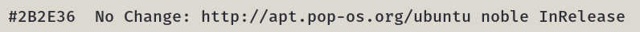
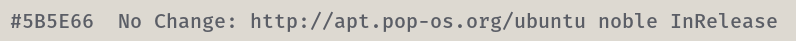
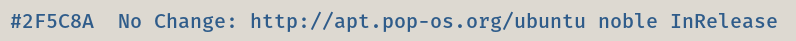
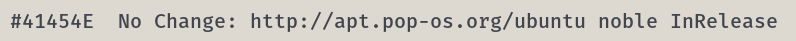

# COSMIC Terminal schemes

Colour schemes for COSMIC Terminal. The desktop `.ron` in `cosmic/` does not
colour ANSI text, so the terminal needs its own import.

1. COSMIC Terminal → **View → Color schemes…** (not Settings → Appearance)
2. **Light** tab → **Import** → a `.ron` from this folder
3. View → Settings → Appearance → Color scheme (light) → the scheme name

If a profile is set as default, set the scheme on that profile too or the
dropdown will look like it did nothing. `cosmic/install.sh` selects **Ember Day**,
so import that one at least.

Every scheme here keeps the 16 ANSI colours of Ember Day. Only the plain text
colour and the dim text change, so bat, lsd, starship, nala and btop look the
same whichever one you pick. The cursor stays ember  `#A4441A`.

The ANSI slots follow the rice: `red` is brick
 `#9E3A3A`; `green` is moss
 `#4C6B45`; `yellow` is
amber  `#8A5E12`; `blue` is
slate blue, the directory colour
 `#2F5C8A`; `magenta` is
heather  `#6E4E8C`; `cyan`
is verdigris, the symlink colour
 `#2E6E6A`; `white` is muted
 `#6B6F78`. Directories are
not affected: `LS_COLORS` in `zsh/emberday.zsh` colours them in truecolor.

## Which one

Ink  `#2B2E36` is the default. The others move through Ember Day's own greys
and tints: calmer above it, brighter below it, for whoever finds the default
glares at night or reads too dim by day.

| Scheme | Plain text | Contrast | Also used for |
|--------|------------|----------|---------------|
| Ember Day Graphite |  `#5B5E66` | 4.6:1 | the bright `white` slot, a step darker than muted text |
| Ember Day Slate |  `#2F5C8A` | 4.9:1 | directories (`LS_COLORS`), the `blue` slot |
| Ember Day Moss |  `#4C6B45` | 4.3:1 | strings, success, the `green` slot |
| Ember Day Ember |  `#A4441A` | 4.4:1 | the accent and the cursor |
| Ember Day Charcoal |  `#41454E` | 6.8:1 | a neutral a step from plain text |
| **Ember Day** (default) |  `#2B2E36` | 9.6:1 | the plain text colour of the rice |

When plain text shares a colour with an ANSI slot, output in that slot stops
standing out: directories in Ember Day Slate, for example, look like plain text.
Errors and numbers stand out more against the dimmer schemes than against
ink.

**Bold:** `bright_foreground` ( `#25272E`) only colours bold text when
`use_bright_bold` is on. The baseline config in `cosmic/config/` leaves it off,
so bold text is the plain text colour at weight 800.

Previews are rendered in Fira Mono on the terminal background  `#DDD9D1`, not
taken from the terminal. In COSMIC you get Maple Mono on the opaque pane, so only the font differs.

## Light

**Ember Day** · `EmberDay-term.ron` · ink  `#2B2E36`, 9.6:1. The default.

**Ember Day Graphite** · `EmberDay-term-graphite.ron` ·  `#5B5E66`, 4.6:1. The bright `white` slot, a step darker than muted text.

**Ember Day Slate** · `EmberDay-term-slate.ron` ·  `#2F5C8A`, 4.9:1. Directories (`LS_COLORS`), the `blue` slot.

**Ember Day Moss** · `EmberDay-term-moss.ron` ·  `#4C6B45`, 4.3:1. Strings, success, the `green` slot.

**Ember Day Ember** · `EmberDay-term-ember.ron` ·  `#A4441A`, 4.4:1. The accent and the cursor.

**Ember Day Charcoal** · `EmberDay-term-charcoal.ron` ·  `#41454E`, 6.8:1. A neutral a step from plain text.

Contrast is plain text on the terminal background, WCAG 2.
